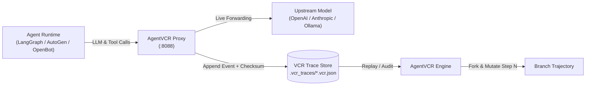

# AgentVCR

[](https://opensource.org/licenses/MIT)
[](https://goreportcard.com/report/github.com/Noooblien/agentvcr)

> **The Flight Recorder and Time-Travel Debugger for Autonomous AI Agents.**

When an autonomous agent fails a 50-step trajectory, hallucinating a parameter or corrupting state at step 23, developers currently face an un-reproducible wall of logs. 

**AgentVCR brings deterministic flight recording, execution replay, and time-travel branching to agentic AI.**

---

## Architecture Overview



---

## Key Features

- **Transparent Low-Overhead Proxy:** Zero code changes required in your agent—point your SDK's `base_url` to `http://localhost:8088/v1`.
- **Deterministic Trajectory Recording:** Records every prompt token, completion, tool invocation argument, and system response with monotonic timestamps and payload hashing.
- **Time-Travel Forking (`fork`):** Branch past execution traces from any arbitrary step ($N$). Mutate the prompt or mock the tool response and re-run without re-executing steps $1 \dots N-1$.
- **Audit & Step-by-Step Viewer (`view`):** Inspect the exact state of the agent context window at any microsecond.

---

## Quick Start

### 1. Installation

```bash
git clone https://github.com/Noooblien/agentvcr.git
cd agentvcr
go build -o bin/agentvcr ./cmd/agentvcr
```

### 2. Start Flight Recorder

```bash
./bin/agentvcr record --port 8088 --target https://api.openai.com
```

### 3. Point your Agent to AgentVCR

In Python (OpenAI SDK):
```python
from openai import OpenAI

client = OpenAI(
    base_url="http://localhost:8088/v1",
    api_key="your-api-key"
)
```

### 4. Inspect or Fork a Trajectory

```bash
# List and inspect all events in a session
./bin/agentvcr view -id trace_1760800000

# Fork from step 5 to branch execution and test alternative prompt paths
./bin/agentvcr fork -id trace_1760800000 -step 5
```

### 5. Trajectory Anomaly Sentry & Circuit Breaker

```bash
# Run real-time trajectory anomaly sentry demo across 4 scenarios
./bin/agentvcr sentry --demo

# Inspect specific trajectory for tool loops, token velocity spikes, and latency outliers
./bin/agentvcr sentry -id trace_1760800000 --mermaid
```

### 6. Trajectory Replay Determinism & Token Benchmark

Empirically assert tool sequence parity, argument stability, token bloat ratio, and replay latency percentiles:

```bash
# Run 4-scenario determinism & token efficiency benchmark
./bin/agentvcr determinism --demo

# Compare replayed candidate run against baseline trace
./bin/agentvcr determinism -base trace_baseline -target trace_replay --min-score 85.0 --strict

# Generate CI/CD markdown summary report for pull request gates
./bin/agentvcr determinism --demo --markdown
```

### 7. Autonomous Agent Chaos & Fault Injection Simulation

Stress-test agent recovery under downstream tool timeouts, rate limits (HTTP 429), transport drops, and upstream 503 outages:

```bash
# Run 5-scenario agent resilience benchmark
./bin/agentvcr chaos --demo

# Generate GitHub Flavored Markdown report with Mermaid sequence diagram
./bin/agentvcr chaos --demo --markdown

# Evaluate custom trajectory under targeted rate-limit fault injection
./bin/agentvcr chaos -id trace_1760800000 -fault rate_limit -rate 0.5 --strict
```

### 8. Hierarchical Execution Flamegraph & Critical Path Profiler

Profile complex multi-turn trajectories across LLM inference, tool execution, and prompt ingestion:

```bash
# Render ANSI terminal execution flame tree with critical path callouts
./bin/agentvcr flame --demo

# Export Speedscope JSON profile for interactive flame chart on speedscope.app
./bin/agentvcr flame --demo -format speedscope -export trace.speedscope.json

# Export Chrome Tracing / Perfetto timeline for chrome://tracing
./bin/agentvcr flame --demo -format chrome -export trace.chrome.json

# Prioritize flame tree by token consumption rather than latency
./bin/agentvcr flame --demo -metric tokens
```

---

## Empirical Benchmarks & Developer Utility

Zero marketing hype. Below are empirical measurements captured directly by the AgentVCR proxy, benchmark engine, and chaos suite (`go test -v ./...`, `agentvcr determinism --demo`, `agentvcr chaos --demo`):

### Trajectory Replay Determinism Benchmark
| Evaluation Scenario | Tool Parity % | Argument Parity % | Token Bloat Ratio | Replay Latency P50 | Proxy Overhead | Verdict |
| :--- | :--- | :--- | :--- | :--- | :--- | :--- |
| **Exact Replay (Nominal)** | `100.0%` | `100.0%` | `1.00x (+0 tok)` | 48.0 ms (σ=72.2ms) | **24 µs / step** | `PASS (100.0/100)` |
| **Argument Drift (Temp Var)** | `100.0%` | `0.0%` | `1.07x (+15 tok)` | 45.0 ms (σ=91.9ms) | **24 µs / step** | `BREACH (53.3/100)` |
| **Tool Path Divergence** | `50.0%` | `100.0%` | `1.00x (+0 tok)` | 52.0 ms (σ=23.3ms) | **24 µs / step** | `DEGRADED (72.5/100)` |
| **Token Explosion Runaway** | `100.0%` | `100.0%` | `3.44x (+1100 tok)` | 90.0 ms (σ=233.3ms) | **24 µs / step** | `DEGRADED (77.5/100)` |

### Agent Chaos & Fault Injection Benchmark (`agentvcr chaos --demo`)
| Experiment Scenario | Steps | Injected | Recovered | Recovery % | MTTR (ms) | Blast Radius | Resilience Score | Status |
|:--------------------|:-----:|:--------:|:---------:|:----------:|:---------:|:------------:|:----------------:|:------:|
| **Nominal Baseline** | 8 | 0 | 0 | 100.0% | 0.0 ms | +0 tok | `100.0/100` | ✅ RESILIENT |
| **Rate Limit Storm (429)** | 8 | 1 | 1 | 100.0% | 2150.0 ms | +120 tok | `100.0/100` | ✅ RESILIENT |
| **Tool Timeout Fallback** | 8 | 1 | 1 | 100.0% | 3350.0 ms | +180 tok | `97.9/100` | ✅ RESILIENT |
| **Intermittent Flakiness** | 8 | 2 | 2 | 100.0% | 385.0 ms | +205 tok | `100.0/100` | ✅ RESILIENT |
| **Cascading Outage (503)** | 8 | 2 | 0 | 0.0% | 0.0 ms | +590 tok | `0.0/100` | ❌ CRITICAL_FAILURE |

---

## Core Developer Capabilities

| Tool / Subcommand | Primary Developer Use Case | Verification Output |
| :--- | :--- | :--- |
| `agentvcr record` | Transparent reverse proxy recording all LLM requests, responses & tool calls | Monotonic JSON flight log (`.vcr_traces/*.vcr.json`) |
| `agentvcr view` | Step-by-step inspector for agent context window and token events | Microsecond-level event waterfall |
| `agentvcr fork` | Branch past trajectories from step $N$ without re-running earlier steps | Isolated child session with parent pointer |
| `agentvcr diff` | Semantic sequence alignment, AST comparison & regression shield | Diff scorecard & Mermaid execution DAG |
| `agentvcr sentry` | Real-time trajectory anomaly sentry & circuit breaker | Tool loop & token velocity detection |
| `agentvcr determinism` | Empirical trajectory replay parity & token efficiency benchmark | ANSI scorecard, Markdown table, JSON gate |
| `agentvcr chaos` | Empirical fault injection simulation & agent resilience testing | ANSI scorecard, Markdown report, Mermaid DAG |
| `agentvcr flame` | Hierarchical execution flamegraph & critical path latency/token profiler | ANSI tree, Speedscope JSON, Chrome Tracing, Mermaid Gantt |
| `agentvcr eval` | CI/CD assertion gates on cost, token budgets, and tool errors | Pass/fail status code for test pipelines |

---

## License

[MIT](LICENSE) © 2026 [Rahul Singh Maraskole](https://github.com/Noooblien)
