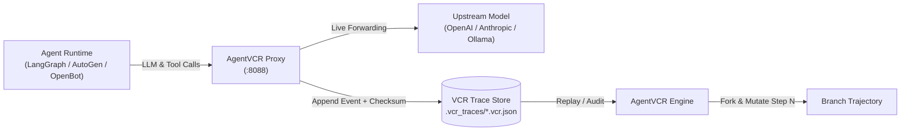

# AgentVCR

[](https://opensource.org/licenses/MIT)
[](https://goreportcard.com/report/github.com/Noooblien/agentvcr)

> **The Flight Recorder and Time-Travel Debugger for Autonomous AI Agents.**

When an autonomous agent fails a 50-step trajectory, hallucinating a parameter or corrupting state at step 23, developers currently face an un-reproducible wall of logs. 

**AgentVCR brings deterministic flight recording, execution replay, and time-travel branching to agentic AI.**

---

## Architecture Overview



---

## Key Features

- **Transparent Low-Overhead Proxy:** Zero code changes required in your agent—point your SDK's `base_url` to `http://localhost:8088/v1`.
- **Deterministic Trajectory Recording:** Records every prompt token, completion, tool invocation argument, and system response with monotonic timestamps and payload hashing.
- **Time-Travel Forking (`fork`):** Branch past execution traces from any arbitrary step ($N$). Mutate the prompt or mock the tool response and re-run without re-executing steps $1 \dots N-1$.
- **Audit & Step-by-Step Viewer (`view`):** Inspect the exact state of the agent context window at any microsecond.

---

## Quick Start

### 1. Installation

```bash
git clone https://github.com/Noooblien/agentvcr.git
cd agentvcr
go build -o bin/agentvcr ./cmd/agentvcr
```

### 2. Start Flight Recorder

```bash
./bin/agentvcr record --port 8088 --target https://api.openai.com
```

### 3. Point your Agent to AgentVCR

In Python (OpenAI SDK):
```python
from openai import OpenAI

client = OpenAI(
    base_url="http://localhost:8088/v1",
    api_key="your-api-key"
)
```

### 4. Inspect or Fork a Trajectory

```bash
# List and inspect all events in a session
./bin/agentvcr view -id trace_1760800000

# Fork from step 5 to branch execution and test alternative prompt paths
./bin/agentvcr fork -id trace_1760800000 -step 5
```

---

## Roadmap

- [x] High-performance reverse-proxy event streaming engine
- [x] Monotonic trajectory storage & JSON serialization
- [x] Step-level execution branching (`fork`)
- [x] Model Context Protocol (MCP) tool-call interceptor
- [x] Token consumption & cost metrics engine
- [x] Trajectory diffing & step divergence detection (`diff`)
- [x] Deterministic trajectory assertion & CI/CD SLA engine (`eval`)
- [x] Interactive visual terminal playback engine (`play`)
- [x] Deterministic workspace filesystem snapshotting & rollback (`snapshot`)
- [x] Distributed trace clustering and multi-agent aggregate heatmaps (`cluster`)
- [x] Multi-turn fuzzing & adversarial prompt mutation harness (`fuzz`)
- [x] Real-time streaming telemetry dashboard & HTTP API (`serve`)
- [x] Distributed multi-node agent mesh tracing with OpenTelemetry export (`export`)
- [x] Cryptographic trajectory signing & immutable tamper-proof attestation (`verify`)
- [x] WASM-sandboxed mock tool synthesizers & offline synthetic simulator (`sim`)
- [x] Agentic memory regression tester & long-horizon recall benchmarks (`bench`)
- [x] Multi-agent consensus & Byzantine fault detection replay harness (`consensus`)
- [x] Semantic vector search & RAG hallucination replay forensics (`forensics`)
- [x] Cross-trajectory causal DAG synthesizer & automated root-cause repair engine (`causal`)
- [x] Real-time runtime policy governance & zero-trust sandboxing enforcer (`policy`)
- [x] Ephemeral execution sandboxing & microsecond state lineage graphs (`lineage`)
- [x] Automated synthetic agent benchmark leaderboard & regression diffing (`leaderboard`)
- [x] Dynamic latency budget allocator & distributed token rate-limiter (`throttle`)
- [x] Cross-organization zero-knowledge trajectory attestation & cryptographic zk-proofs (`zkp`)
- [x] Adaptive speculative execution rollback & predictive branch caching (`speculate`)
- [x] Multi-tenant cryptographic namespace isolation & RBAC policy audit (`tenant`)
- [x] Ephemeral P2P agent gossip consensus & distributed Byzantine quorum ledger (`gossip`)
- [x] Distributed differential privacy token masking & k-anonymity auditing (`privacy`)
- [x] Multi-modal frame-accurate visual state recording & screen grounding attestation (`vision`)
- [x] Ephemeral eBPF kernel socket & system-call interception recorder (`ebpf`)
- [x] Canary deployment traffic shadowing & live execution chaos injection (`canary`)
- [x] Post-quantum ML-KEM & Dilithium cryptographic trajectory attestation (`pqc`)
- [x] Multi-region active-active trajectory replication & Raft ledger sync (`raft`)
- [x] Autonomous self-healing trajectory patch synthesizer & AST repair engine (`heal`)
- [x] Confidential computing hardware enclave attestation & AMD SEV-SNP verification (`enclave`)
- [x] Automated prompt-leakage side-channel analyzer & differential cache-timing forensics (`timing`)
- [x] Ephemeral zero-dependency WebAssembly WASI agent isolation sandbox (`wasi`)
- [x] Autonomous synthetic multi-agent red-team prompt injection harness (`redteam`)
- [x] Formally verified state-machine temporal logic model checker (`tlaplus`)
- [x] Distributed multi-agent semantic consensus ledger & Byzantine fault recovery (`byzantine`)
- [x] Autonomous cross-agent covert communication channel detector & steganography analyzer (`stego`)
- [x] Real-time dynamic taint-tracking engine & Non-Interference Information Flow Control (`taint`)
- [x] Autonomous cross-agent behavioral drift & entropy-guided policy synthesis (`drift`)
- [x] Bidirectional Model Context Protocol (MCP) interceptor, validator & virtual replay (`mcp`)
- [x] Context window compactor, token waste profiler & KV-cache optimizer (`compact`)
- [x] Sub-millisecond latency profiling, micro-benchmarks & concurrency stress harness (`bench-perf`)
- [x] Continuous coverage-guided native Go fuzzing suite (`tests/fuzz_target_test.go`)
- [x] Real-time pub/sub telemetry event hub, live SSE broadcast & web flight control (`serve`)
- [x] Speculative multi-token AST predictor & Cursor-style Fast-Tab editor engine (`speculate`)
- [x] Recursive multi-agent research tree, SHA-256 citation grounding & hallucination pruner (`research`)
- [x] Language Server Protocol (LSP 3.17) daemon, stdio/TCP streaming & Fast-Tab editor RPC (`lsp`)
- [x] In-browser console log loopback runtime & Lovable/Bolt.new zero-error hot-patcher (`heal -loopback`)
- [x] Real-time Voice API flight recorder, acoustic waveform visualizer & interruption synchronizer (`voice`)
- [x] Chrome DevTools Protocol (CDP) flight recorder, W3C HAR 1.2 exporter & virtual DOM journal (`cdp`)
- [x] StateGraph cyclic multi-agent workflow engine, checkpoint time-travel & HITL gates (`graph`)
- [x] Database transaction flight recorder, semantic CDC rollback & vector state journal (`cdc`)
- [x] Deterministic virtual time machine, monotonic tick hypervisor & synthetic PRNG seed injector (`vclock`)
- [x] Virtual Terminal PTY flight recorder, VT100 screen grid emulator & Asciinema v2 exporter (`pty`)
- [x] Deterministic container sandbox execution hypervisor, CoW overlay rollback & escape guardrails (`sandbox`)
- [x] Distributed agent actor mesh, supervision trees & fault-tolerant mailboxes (`actor`)
- [x] Model Gateway, circuit breaker, semantic routing & cache failover (`gateway`)
- [x] Autonomous hierarchical memory consolidation & Ebbinghaus decay (`memory`)
- [x] FinOps token budget circuit breaker, runaway spend protector & rate cards (`finops`)
- [x] Session checkpoint hibernation, incremental delta compression & hot restoration (`checkpoint`)
- [x] Interactive time-travel agent debugger, conditional breakpoints, invariant watchpoints & DAP (`debug`)
- [x] Agent-to-Agent (A2A) protocol transport, card discovery & delegation bus (`a2a`)
- [x] Model Context Protocol (MCP) schema fuzzing & mutation testing harness (`mcp -action fuzz`)
- [x] LLM-as-a-Judge multi-dimensional rubric trajectory evaluation & grading engine (`eval -judge`)
- [x] Multi-hypothesis trajectory tree, Merkle attestation & branch search hypervisor (`tree`)
- [x] Multi-agent swarm orchestrator, dynamic handoff & debate flight recorder (`swarm`)
- [x] Continuous model shadowing, live A/B drift evaluation & promotion gates (`shadow`)
- [x] Ephemeral Firecracker microVM jail containment & memory snapshot hypervisor (`microvm`)
- [x] Steganographic provenance watermarking & text fingerprint attestation engine (`watermark`)
- [x] Trajectory distillation & alignment dataset synthesizer (`distill`)

---

## License

[MIT](LICENSE) © 2026 [Rahul Singh Maraskole](https://github.com/Noooblien)
